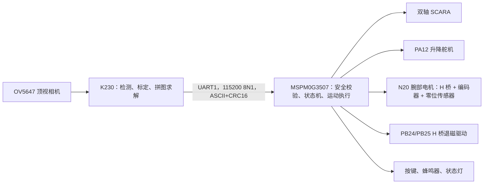

# 2026 年 E 题“拼图装置”技术方案

版本：V1.1  
日期：2026-07-29  
平台：现有 2-DOF SCARA 写字机 + MSPM0G3507 + CanMV-K230 + OV5647  
目标：先稳定获得自备拼图片的 50 分，再在相同硬件上增加现场白色拼图 20 分和扑克牌图案拼图 30 分

---

## 1. 结论与总策略

现有写字机可以改造成拼图装置，而且最快方案不是重写运动控制，而是保留已经验证过的双轴运动、回零、逆运动学和步进队列，只增加以下四项：

1. 顶视 K230 视觉；
2. 末端升降机构；
3. 带机械退料和双向退磁的电磁吸取器；
4. 与电磁铁同轴、带编码器的 N20 腕部减速电机。

第一阶段必须只做“自备四块、固定目标”的 50 分方案。K230 识别四块已知拼图片，查固定目标位姿表，直接把机器人用户坐标发送给 MSPM0。MSPM0 只负责校验、规划和执行，不在第一阶段承担图像识别或拼图求解。

第一阶段通过验收之前，不开发通用拼图和扑克牌纹理算法。

得分路线固定如下：

| 阶段 | 对应得分 | 拼图片 | K230 算法 | MSPM0 改动 | 放行条件 |
|---|---:|---|---|---|---|
| P1 | 20+30=50 分 | 自备四块、颜色和形状固定 | 轮廓检测、模板匹配、固定目标位姿表 | 拼图状态机、协议、腕部、磁铁 | 10 次连续全成功且总时间不超过 100 s |
| P2 | +20 分 | 现场纯白、形状未知 | 多边形提取、边匹配、矩形约束搜索 | 原则上不改运动层 | 20 组随机拼图成功率不低于 95% |
| P3 | +30 分 | 现场扑克牌图案 | 几何候选 + 接缝纹理评分 | 只扩展协议中的算法版本和置信度 | 纹理拼接成功率不低于 90% |

最终系统职责边界如下：



---

## 2. 题目约束转化为工程指标

### 2.1 比赛动作约束

- A4 纸竖放；
- 拼图片初始位置在 A4 上半区，位置和姿态随机；
- 成品必须位于 A4 下半区；
- 按键启动后不得人工干预；
- 从启动到完成不超过 2 min；
- 完成后必须有声或光提示；
- 拼图片数量不超过 4；
- 现场拼图片不超过 5 条边，每条边不短于 2 cm；
- 相邻拼图片之间不得重叠，相邻顶点距离不超过 2 cm；
- 现场目标矩形尺寸范围为 9 cm × 5 cm 至 12 cm × 9 cm；
- 现场拼图片为 0.3 mm 镀锌铁片覆纸，总厚度不超过 2 mm、单片质量不超过 30 g。

### 2.2 本方案内部指标

题目允许 20 mm 顶点误差，但内部必须按更严格指标设计：

| 项目 | 设计指标 | 最低放行指标 |
|---|---:|---:|
| 视觉到末端综合定位误差 | ≤3 mm | ≤5 mm |
| 放置角度误差 | ≤2° | ≤4° |
| 自备拼图接缝 | 3～5 mm | 顶点距离 ≤10 mm |
| 单片拾取成功率 | ≥99% | 连续 40 次不掉片 |
| 释放时间 | ≤200 ms | ≤300 ms |
| 单片完整搬运时间 | ≤18 s | ≤20 s |
| P1 视觉与规划时间 | ≤1 s | ≤2 s |
| P1 四片总时间 | ≤90 s | ≤100 s，绝不能超过 115 s |

内部预留 20 s 作为偶发通信重试、腕部闭环波动和机械振动余量。

---

## 3. 现有代码基线与复用结论

### 3.1 已确认的现有参数

| 项目 | 当前值 | 所在文件 | 处理方式 |
|---|---:|---|---|
| 大臂长度 | 205 mm | `APP/Inc/app_writer_motion.h` | 保留 |
| 小臂长度 | 203 mm | `APP/Inc/app_writer_motion.h` | 保留 |
| 关节 1 标定 | 40.099216 step/° | 同上 | 保留 |
| 关节 2 标定 | 40.115790 step/° | 同上 | 保留 |
| 关节 1 软件上限 | 135° | 同上 | 保留，重新做全域实机验证 |
| 关节 2 软件上限 | 255° | 同上 | 保留，重新做全域实机验证 |
| 当前快速频率 | 200 Hz | 同上 | P1 必须做提速验证 |
| 抬笔舵机 | PA12/TIMG0，0° 下、90° 上 | `APP/Src/app_servo.c` | 改为末端升降 |
| 视觉串口 | UART1，PB4/PB5，115200 8N1 | `COMM/Inc/comm_vision_uart.h` | 完整复用底层 |
| 串口行帧入口 | 最大约 192 B，转交任务层 | `COMM/Src/comm_vision_uart.c` | 仅改路由 |
| 当前任务模式 | G-code Serial | `TASK/writer_test.h` | 增加独立 Puzzle 模式 |
| 现有纸张映射范围 | x=25～185 mm，y=45～265 mm | `APP/Inc/app_writer_paper_map.h` | P1 不修改 |

### 3.2 必须保留的代码

以下模块已承担写字机最难的部分，不应为拼图功能重写：

- `MID/Src/mid_scara.c`：正逆运动学；
- `TASK/writer_home.c`：双轴回零；
- `APP/Src/app_writer_motion.c`：关节限制、路径分段和运动封装；
- `APP/stepper/Src/app_stepper.c`：步进队列、加减速和 AMASS；
- `APP/Src/app_servo.c`：现有 PA12 升降 PWM；
- `COMM/Src/comm_vision_uart.c`：UART 中断、收发环形缓冲和行帧提取。

### 3.3 第一阶段禁止修改的模块

- 不改 `mid_scara.c` 的运动学模型；
- 不改现有写字坐标标定数据；
- 不在 `app_writer_paper_map.*` 上继续叠加拼图补偿；
- 不把 K230 的视觉算法塞进 MSPM0；
- 不让 K230 逐点遥控步进电机；
- 不在 P1 引入神经网络模型。

这样可以把写字功能和比赛功能隔离，避免为了拼图破坏当前可工作的写字基线。

### 3.4 当前工程文件注意事项

当前真正包含 `app_writer_motion.c`、`app_stepper.c`、`app_servo.c`、`writer_test.c` 和 `comm_vision_uart.c` 的 Keil 工程是：

`keil/gpio_toggle_output_LP_MSPM0G3507_nortos_keil.uvprojx`

新增源文件必须加入这个工程。`APP/servo/` 与 `APP/Inc + APP/Src`、多个 Keil 工程之间存在历史重复文件，拼图版本只允许引用当前有效构建中的以下文件：

- `APP/Inc/app_servo.h`
- `APP/Src/app_servo.c`
- `APP/stepper/Inc/app_stepper.h`
- `APP/stepper/Src/app_stepper.c`

不得把旧目录下的同名文件重新加回工程。

### 3.5 当前已实现：四角区域巡检 V1

已新增 `TASK/puzzle_area_probe.c/h`，并将当前 `WRITER_TEST_MODE` 切换为 `WRITER_TEST_MODE_PUZZLE_AREA_PROBE`。上电回零成功后等待 3 s 自动开始；`M850` 可用于跳过等待并提前启动。末端全程抬起，按以下路线移动：

```text
(25,75) -> (185,75) -> (185,235) -> (25,235) -> (25,75) mm
```

这是当前纸张映射中明确标为 `CALIBRATED` 的矩形，不包含 y=45～75 mm 和 y=235～265 mm 的外推区。到达前四个唯一角后，PA12 舵机落笔保持 700 ms 形成标记点，再抬笔稳定 700 ms；第五次返回左下角时不重复打点。每个位置额外停留 2 s，`STOP` 可随时急停。当前巡检任务尚未控制 N20 和电磁铁，实机测试时必须让这两个执行器保持独立安全关闭。

---

## 4. 最快获得 50 分的技术方案

### 4.1 自备拼图片标准

自备四块也统一使用 0.3 mm 镀锌铁片覆纸，保证 P1 和现场题共用同一吸盘。

建议标准：

- 四块均使用同一种高亮纯色，例如亮黄色或亮绿色；
- A4 工作纸使用无反光深蓝色或黑色；
- 四块外形必须明显不同，避免旋转后轮廓相似；
- 每块设置唯一轮廓特征，最短边建议不小于 25 mm；
- 所有尖角做 0.5～1 mm 小圆角，避免挂纸；
- 每块质量控制在 15～25 g；
- 每块背面不得加磁铁，只保留铁磁性；
- 目标拼图外接矩形固定为 100 mm × 60 mm。

坐标系统一定义为：A4 纸左下角为 `(0,0)`，x 向右，y 向上。下半区为 `0≤y≤148.5 mm`。P1 目标矩形固定放置在：

- 左下角 `(55,50) mm`；
- 右上角 `(155,110) mm`；
- 中心 `(105,80) mm`。

该目标完全位于下半区，同时落在现有已标定区域附近。四块的目标位姿从 CAD 直接导出，写入 K230 的 `target_poses.py`，不在比赛时求解。

### 4.2 P1 视觉流程

K230 使用经典视觉，不使用 AI：

1. 机器人回零并移动到 `VISION_PARK`，机械臂不得遮挡 A4；
2. K230 连续取 5 帧，自动曝光稳定后取中值帧；
3. 根据 A4 四角标定把图像透视校正为纸张平面；
4. 转 HSV 或 LAB，提取高亮自备拼图片；
5. 开闭运算去噪；
6. `findContours` 提取四个主轮廓；
7. `approxPolyDP` 得到多边形，计算面积、边长、Hu 矩和最小外接矩形；
8. 使用面积比例、边数和 `matchShapes` 与四个离线模板匹配；
9. 对每片使用距离变换寻找“最大内接圆中心”作为吸取点，不直接使用可能落在凹槽外的几何质心；
10. 根据固定目标位姿表计算目标吸取点位置；
11. 将四片计划一次性发送给 MSPM0；
12. MSPM0 全部校验通过后才开始运动。

选择最大内接圆中心的原因是：它离轮廓边界最远，电磁铁最不容易压在拼图片边缘或空洞上。

### 4.3 直接手眼标定，绕开旧纸张映射

P1 最快的坐标策略是让 K230 直接输出现有 `WriterMotion` 使用的用户坐标，不调用 `WriterPaperMap_To_User()`。

标定过程：

1. 在电磁铁轴心安装一个可拆卸高对比度圆形标记；
2. MSPM0 依次运动到覆盖 A4 的 3×3 共 9 个已知用户坐标；
3. K230 检测每个位置的末端轴心像素坐标；
4. 拟合像素坐标到机器人用户坐标的单应矩阵 `H_pixel_to_user`；
5. 同时由 A4 四角拟合 `H_pixel_to_paper`；
6. 保存标定矩阵和日期、机械版本、相机分辨率到 K230 存储卡；
7. 使用另外 5 个验证点检查误差。

坐标换算为：

```text
[u, v, 1]^T  --H_pixel_to_user-->  [x_user, y_user, w]^T
[x_user, y_user] = [x_user/w, y_user/w]
```

目标点先由纸张坐标变到像素，再变到机器人用户坐标。若 5 个验证点的最大误差超过 5 mm，不允许运行比赛程序；优先检查相机松动、A4 定位夹具和工具轴心，不用软件硬补。

如果单应性残差仍明显，再增加 4×4 标定点并叠加双线性残差表。该补偿仍放在 K230，不动写字坐标映射。

### 4.4 机械臂遮挡处理

顶视相机可能被 SCARA 两根连杆遮挡。P1 必须定义一个实测的 `VISION_PARK` 位姿，并满足：

- 末端和两根连杆在取图时均不遮挡上半区四片拼图；
- 停稳 300 ms 后才允许拍照；
- 该位姿经过现有运动学和关节限制检查；
- 若单一停靠位仍有遮挡，则使用两个停靠位各拍一张并合并轮廓。

最快方案是调整 A4 与机械臂底座的相对位置，使一个停靠位即可看清整张 A4。

### 4.5 搬运顺序

P1 不做复杂路径优化，只使用稳定的最近邻：

1. 从 `VISION_PARK` 出发，选择当前末端距离最近的拼图片；
2. 目标区先放最靠内、最不容易被后续末端碰到的拼图片；
3. 同距离时优先放置目标区域左侧，再放右侧；
4. 每完成一片更新当前位置，选择下一片。

四片规模下，穷举 `4! = 24` 个顺序也很便宜。最终可以直接计算 24 条路线的估计关节行程，选最短且不穿越已放拼图片的顺序。

---

## 5. 末端执行器与腕部旋转

### 5.1 为什么必须增加腕部旋转

现有 SCARA 的末端方向会随第二关节角变化，双轴只能控制 `(x,y)`，不能独立控制拼图片的最终角度。若没有腕部旋转，即使抓到拼图片，也无法保证它以目标姿态放下。

定义：

- `ψ`：现有第二关节的全局方向量；
- `φ`：N20 腕部输出轴相对小臂的角度；
- `γ = ψ + φ`：电磁铁工具在纸面内的全局方向；
- `αs`：拼图片拾取时角度；
- `αt`：拼图片目标角度。

腕部需要完成的角度变化为：

```text
Δφ = wrap180(αt - αs - (ψt - ψs))
```

`wrap180()` 把结果归一化到 `[-180°, 180°]`。因此腕部有效可用角度只要大于 200°，就能留出机械限位余量完成任意最短旋转。N20 本身可以连续旋转，但若电磁铁导线没有滑环，软件必须限制在约 `[-170°,170°]`，并在任务间回零和解缠，禁止累计绕线。

### 5.2 末端结构顺序

推荐从小臂末端向下依次为：

1. 带输出轴编码器反馈的 N20 金属减速电机；
2. N20 H 桥驱动和腕部零位传感器；
3. 同轴轻量旋转盘；
4. 现有 PA12 升降连杆或滑台；
5. 弹簧柔顺段；
6. 圆形电磁铁；
7. 三点弹簧退料针或带失动行程的非磁性退料环。

电磁铁中心、腕部旋转轴和视觉标定轴必须尽量同轴，同轴度目标 ≤1 mm。否则腕部旋转会让吸取点画圆，增加额外标定和碰撞风险。

### 5.3 拾放动作

每片固定执行：

1. 升降保持 `UP`；
2. 移动到拾取点上方；
3. 预置拾取腕部角度；
4. 升降到 `DOWN`；
5. 电磁铁通电，等待 120～180 ms；
6. 升降到 `UP`；
7. 在安全高度移动，并在空中完成腕部旋转；
8. 到达目标点；
9. 升降到 `DOWN`；
10. 退出正常吸取电流，退料机构保持拼图片不被残磁带走；
11. H 桥执行快速电流衰减和递减交替退磁；
12. 退料针把拼图片与磁极面拉开 1.5～2.0 mm；
13. 等待 100～250 ms；
14. 升降到 `UP`。

禁止贴着纸面旋转拼图片；所有旋转必须在提升后进行。

### 5.4 剩磁处理方案

断电后仍有吸力可能来自两部分：

1. 续流回路使线圈电流缓慢衰减；
2. 电流已归零，但铁芯和镀锌铁片仍处于磁滞回线上的剩磁状态。

普通低边 MOS 加并联续流二极管只能保护开关管，不能消除剩磁，而且低压续流会延长电流下降时间。比赛版本采用“机械退料为主、H 桥退磁为辅”：

- 电磁铁周围布置 3 根 POM/尼龙退料针，按 120° 分布；
- 退料针无压力时比磁极面突出 1.5～2.0 mm；
- 下压拾取时弹簧被压缩，磁极面接触或接近拼图片；
- 放置断电后，退料针先把拼图片压在纸面，磁铁上移并产生空气间隙；
- 三根弹簧总退料力目标为 0.5～0.8 N；
- 带退料机构时，电磁铁隔纸实测吸力提高到 ≥2 N，保证净保持力仍有余量；
- 磁极面增加 0.2～0.4 mm PET/PTFE 非磁垫片，以降低接触剩磁；最终厚度以吸取试验为准。

电气上把单向 MOS 驱动改为 H 桥。退磁不是简单地“反接一下”，单个过强反向脉冲只会留下反方向剩磁。正确方式是让线圈电流正负交替并逐级减小，例如以实测保持电流 `Ihold` 为基准：

```text
正常吸取：       +1.00 Ihold
快速过零：       H 桥反向加压，直到原正向电流衰减到 0
第 1 个退磁峰值：-0.30 Ihold
第 2 个退磁峰值：+0.15 Ihold
第 3 个退磁峰值：-0.08 Ihold
关闭输出：       0，H 桥高阻
```

每一级初始持续 10～30 ms，总退磁时间目标不超过 120 ms。上述数值是调试起点，最终必须用串联采样电阻、示波器或驱动器电流检测脚观察实际线圈电流，不能直接把 PWM 占空比等同于电流比例。

若机械退料已经能够连续 40 次可靠释放，可以缩短电气退磁序列；但机械退料不得取消。

---

## 6. 硬件标准

### 6.1 视觉部分

| 项目 | 确定标准 |
|---|---|
| 视觉主控 | CanMV-K230 开发板 |
| 相机 | OV5647，固定焦距，刚性顶视安装 |
| 固件 | 官方 CanMV-K230 v1.8；比赛版本冻结，禁止临场升级 |
| 工作分辨率 | 标定和检测分辨率一致，建议 1280×720 或能够稳定达到的最接近分辨率 |
| 画面要求 | A4 全部进入画面，四周至少保留 20 px 边界 |
| 纸面有效像素 | A4 纸区域至少约 900×600 px |
| 安装高度 | 由镜头视场实测确定，预计 400～500 mm |
| 相机倾斜 | 光轴与纸面法线夹角 ≤2°；仍保留单应性校正 |
| 固定刚度 | 按压机架后恢复，标定点漂移 ≤2 px |
| 照明 | 两侧漫反射白光，避免电磁铁和铁片高光 |

K230 首次刷机后必须运行烟雾测试：

```python
import cv2
from machine import UART
```

并完成一次 `Sensor.snapshot()`、一次轮廓提取和一次 UART 回环。若 v1.8 对选定板型或脚本不兼容，统一退回官方 v1.7 后冻结版本，不能混用版本。

### 6.2 N20 腕部旋转电机

| 项目 | 确定标准 |
|---|---:|
| 类型 | N20 金属减速电机，必须带正交编码器或增加输出轴绝对角度传感器 |
| 额定电压 | 优先 6 V |
| 输出转速 | 建议 60～100 r/min，兼顾速度和可控性 |
| 输出堵转扭矩 | ≥1 kg·cm，并按堵转电流选择驱动 |
| 输出轴编码器分辨率 | 四倍频后 ≥720 count/rev，推荐 ≥2000 count/rev |
| 零位 | 独立霍尔/光电零位开关，上电必须回零 |
| 重复角度误差 | ≤2° |
| 控制 | 约 20 kHz H 桥 PWM，1 kHz 位置环 |
| 无滑环有效范围 | 约 `[-170°,170°]`，软件限位和机械限位同时存在 |
| 供电 | 独立 6 V 支路，不从 MSPM0 3.3 V 取电 |

不带编码器的普通 N20 只能按时间估算角度，电压、负载和齿轮摩擦变化都会导致累计误差，不能作为最终拼图角度执行器。若现有 N20 没有编码器，至少增加同轴 AS5600 类角度传感器和零位校准；最快、代码最简单的方案仍是直接使用带编码器 N20。

### 6.3 升降机构

| 项目 | 确定标准 |
|---|---:|
| 复用输出 | PA12/TIMG0 |
| 有效抬升量 | ≥8 mm |
| 下压柔顺量 | ±2 mm |
| 单次到位时间 | ≤250 ms |
| 下压力 | 只需保证贴合，不得压弯 A4 |
| 上电安全位 | `UP` |

现有 700 ms 启动等待只用于上电安全，不作为每次拾放等待。比赛状态机内的升降等待从 250 ms 起测，逐步缩短。

### 6.4 电磁铁与驱动

| 项目 | 确定标准 |
|---|---:|
| 电磁铁形式 | 小型圆形直流吸盘电磁铁 |
| 纸层隔开后的实测保持力 | ≥1 N |
| 释放时间 | ≤300 ms |
| 末端新增总质量 | 目标 ≤60 g |
| 驱动方式 | 双向 H 桥，支持正向吸取、快速衰减和反向退磁 |
| 推荐驱动 | 4.5～48 V 线圈优先 DRV8251A 或同等级带限流/电流反馈 H 桥 |
| 驱动余量 | 峰值电流额定值 ≥线圈实测冷态电流的 2 倍，并按 PCB 散热降额 |
| 电流检测 | 优先使用驱动器 IPROPI/ISEN，或串联低阻采样电阻留测试点 |
| 复位状态 | H 桥两个输入均为关闭/高阻，外部下拉保证 MCU 复位时不吸合 |
| 机械退料 | 必须有三点弹簧退料针或等效失动退料环 |

DRV8251A 的工作电压下限为 4.5 V；若实际线圈、现成模块或采购条件不同，必须根据线圈额定电压、冷态电阻和实测电流重新选型，不能在不知道线圈电流时直接焊驱动板。

电磁铁选型不以厂家标称“吸力”验收，必须隔着实际覆纸、非磁垫片和退料针弹簧力，用 30 g 拼图片做加速度、急停和 40 次循环测试。

### 6.5 供电

| 电源支路 | 标准 |
|---|---|
| K230 | 5 V / 3 A 独立稳压支路 |
| 升降舵机与 N20 | 5～6 V / ≥3 A 独立支路 |
| 电磁铁 | 按线圈额定电压配置，独立支路 |
| MSPM0 与步进驱动 | 保留现有供电 |
| 接地 | 所有逻辑地单点共地 |
| 去耦 | 升降舵机和 N20 驱动附近 ≥470 μF + 0.1 μF；K230 输入附近按板卡要求去耦 |
| 禁止项 | 禁止用 MSPM0 3.3 V 给舵机、N20、电磁铁或 K230 供电 |

### 6.6 MSPM0 引脚冻结表

| 功能 | 引脚/外设 | 状态 |
|---|---|---|
| 关节 1 STEP/DIR | PA10/TIMA1、PA11 | 保留 |
| 关节 2 STEP/DIR | PA8/TIMA0、PA9 | 保留 |
| 两轴限位 | PA26、PA27 | 保留 |
| 升降舵机 | PA12/TIMG0_CCP0 | 保留并改语义 |
| K230 UART | PB4 TX、PB5 RX、UART1 115200 8N1 | 保留 |
| N20 PWM | TIMG7 硬件 PWM；PB25/TIMG7_CCP0 为候选 | 新增，最终引脚需避开已经实现的消磁电路 |
| N20 H 桥方向 | 两路 GPIO；PA14、PA15 为候选 | 新增，外部下拉保证复位停机 |
| N20 编码器 A/B | PB21/PB22，TIMG8_CCP0/CCP1 QEI | 新增；拼图构建中不再作为 LED |
| N20 零位 | PB16 GPIO 输入为候选 | 新增；拼图构建中不再作为 LED4 |
| 电磁铁消磁控制 | 沿用已经验证的实际引脚 | 必须在接入 N20 前记录到 `puzzle_config.h` 并做冲突检查 |
| 启动按键 | PB0 GPIO 输入 | 复用 KEY1 |
| 完成蜂鸣器 | PB23 GPIO/PWM | 新增 |
| 完成/故障灯 | PB27 板载 LED | 复用 LED3 |

历史 `app_encoder_motor.*` 没有加入当前有效工程，只实现了开环速度和编码器累计值，没有角度目标、回零、位置 PID、软件限位和堵转故障，不能直接作为腕部成品代码。新腕部模块可以复用其硬件思路，但必须独立实现。所有候选引脚要与实际消磁电路核对后，在 `TI_moban.syscfg` 中锁定，再生成 `ti_msp_dl_config.c/h`，不得只手改生成文件。

### 6.7 K230 与 MSPM0 电气连接

逻辑连接固定为：

```text
K230 UART1_TX -> 电平转换 -> MSPM0 PB5/UART1_RX
K230 UART1_RX <- 电平转换 <- MSPM0 PB4/UART1_TX
K230 GND -------------------- MSPM0 GND
```

K230 不同开发板、不同 IO 域可能是 1.8 V 或 3.3 V。硬件标准采用两片固定方向的 `SN74AXC1T45` 或等效双电源单比特电平转换器：

- K230 侧电源接该 UART IO 域实际电压；
- MSPM0 侧接 3.3 V；
- 两个方向引脚固定，不使用自动方向猜测；
- 不连接两块板的 5 V/VCC；
- 禁止把 5 V UART 直接接到 K230。

K230 的具体 FPIOA 物理 IO 号必须根据实物板卡版本和原理图写入 `config.py`，不能把其他 K230 板型的 IO3/IO4 直接当成通用结论。

---

## 7. K230 到 MSPM0 的传输方案

### 7.1 总原则

P1 复用现有 UART 行帧机制，采用 ASCII 文本帧加 CRC16，不先做二进制协议。原因：

- 当前 `comm_vision_uart.c` 已支持按行收帧；
- 串口日志容易抓取；
- 四片计划数据量极小，115200 baud 完全足够；
- 发生坐标异常时可以直接读出；
- 后续仍可无损扩展算法版本和置信度。

K230 一次发送完整计划，MSPM0 校验全部四片后才执行。K230 不在运动过程中连续发送轨迹点。

### 7.2 帧格式

```text
@PAYLOAD*CCCC\r\n
```

- `PAYLOAD`：逗号分隔的 ASCII 字段；
- `CCCC`：4 位大写十六进制 CRC16-CCITT-FALSE；
- CRC 参数：poly=`0x1021`，init=`0xFFFF`，refin=false，refout=false，xorout=`0x0000`；
- CRC 范围：`@` 与 `*` 之间的全部字节，不包含 `@` 和 `*`；
- 单帧长度不得超过 160 B；
- 坐标使用 0.1 mm 整数；
- 角度使用 0.1° 有符号整数；
- 禁止在协议中发送浮点字符串。

### 7.3 消息定义

握手：

```text
@HELLO,protocol_version,boot_id*CRC\r\n
```

MSPM0 回零、抬升、停靠完成后请求拍照：

```text
@CAPTURE,session_id*CRC\r\n
```

K230 开始发送计划：

```text
@PLAN_BEGIN,session_id,piece_count,algorithm_id,confidence_permille*CRC\r\n
```

每片：

```text
@PIECE,session_id,index,piece_id,pick_px10,pick_py10,pick_ux10,pick_uy10,src_a10,place_px10,place_py10,place_ux10,place_uy10,dst_a10*CRC\r\n
```

其中：

- `pick_px10/pick_py10`：拾取点的 A4 纸坐标，用于分区和日志校验；
- `pick_ux10/pick_uy10`：拾取点的机器人用户坐标；
- `place_px10/place_py10`：放置点的 A4 纸坐标；
- `place_ux10/place_uy10`：该拾取点映射到目标位姿后的机器人用户坐标；
- `src_a10/dst_a10`：拼图片源角度和目标角度；
- `piece_id`：P1 为 0～3 的模板编号，P2/P3 为本次求解产生的编号。

计划结束：

```text
@PLAN_END,session_id*CRC\r\n
```

确认：

```text
@ACK,session_id,rx_seq,code*CRC\r\n
```

状态：

```text
@STATE,session_id,state,piece_index,error_code*CRC\r\n
```

### 7.4 会话和重试

- 每次按键启动创建新的 16 bit `session_id`；
- MSPM0 只接受当前会话的数据；
- 每帧正确后返回 ACK；
- K230 300 ms 未收到 ACK，最多重发 3 次；
- 重复帧必须幂等，不得重复加入计划；
- `PLAN_END` 后 MSPM0 统一检查数量、索引、ID、CRC、范围、IK 可达性和腕部角度；
- 任一项失败，整份计划拒绝，绝不执行半份计划；
- 视觉计划总接收超时 3 s；
- 超时后 MSPM0 保持 `UP`、磁铁关闭并报告错误。

### 7.5 安全校验

每个计划点在进入运动队列前必须通过：

1. `piece_count` 在 1～4；
2. `index` 无重复；
3. P1 的四个 `piece_id` 唯一；
4. 用户坐标绝对值和协议整数范围合法；
5. 调用现有逆运动学确认可达；
6. 关节角满足当前软限位；
7. 拾取点对应纸张上半区，放置点对应纸张下半区；
8. 腕部起止角均处于标定有效范围；
9. 所有输出初始状态为升起、磁铁关闭。

MSPM0 不完全信任 K230。即使 CRC 正确，只要坐标不可达，也必须拒绝计划。

---

## 8. MSPM0 软件改动方向

### 8.1 新增文件

```text
TASK/
  puzzle_task.h
  puzzle_task.c
  puzzle_config.h

COMM/Inc/
  puzzle_protocol.h
COMM/Src/
  puzzle_protocol.c

APP/Inc/
  app_wrist_motor.h
  app_magnet.h
  app_puzzle_io.h
APP/Src/
  app_wrist_motor.c
  app_magnet.c
  app_puzzle_io.c
```

各文件职责：

| 文件 | 职责 |
|---|---|
| `puzzle_task.*` | 比赛状态机、四片计划缓存、动作顺序、错误处理 |
| `puzzle_config.h` | 速度、超时、N20 编码器参数、腕部角度、停靠点和安全范围 |
| `puzzle_protocol.*` | CRC16、ASCII 解析、会话、ACK、完整计划校验 |
| `app_wrist_motor.*` | N20 回零、编码器计数、位置 PID、H 桥 PWM、角度限位、堵转和到位判断 |
| `app_magnet.*` | 按已验证引脚完成电磁铁安全初始化、吸取、退磁和故障关断 |
| `app_puzzle_io.*` | PB0 启动按键、PB23 蜂鸣器、PB27 状态灯 |

P1 不新增 `app_puzzle_map.c`。像素到机器人用户坐标由 K230 的手眼标定完成。

### 8.2 修改文件

| 文件 | 最小改动 |
|---|---|
| `TASK/writer_test.h` | 增加 `WRITER_TEST_MODE_PUZZLE` |
| `TASK/writer_test.c` | 在 Start/Update/SerialFrame 三处路由到 `PuzzleTask` |
| `COMM/Src/comm_vision_uart.c` | 拼图模式下把完整行交给 `PuzzleProtocol_ProcessFrame()` |
| `main.c` | 在回零前安全初始化腕部、升降、磁铁和提示 IO；拼图构建关闭云端/G-code |
| `TI_moban.syscfg` | 锁定 TIMG7 PWM、TIMG8 QEI、零位输入和新增 GPIO |
| `ti_msp_dl_config.c/h` | 由 SysConfig 重新生成 |
| 有效 Keil `.uvprojx` | 加入新增源文件和头文件路径 |

### 8.3 MSPM0 状态机

```text
BOOT_SAFE
  -> HOME
  -> WAIT_KEY
  -> VISION_PARK
  -> CAPTURE_REQUEST
  -> PLAN_RX
  -> PLAN_VALIDATE
  -> PICK_APPROACH
  -> WRIST_PICK
  -> LOWER_PICK
  -> MAGNET_ON
  -> LIFT_WITH_PIECE
  -> MOVE_TO_PLACE
  -> WRIST_PLACE
  -> LOWER_PLACE
  -> MAGNET_OFF
  -> LIFT_CLEAR
  -> NEXT_PIECE
  -> FINAL_PARK
  -> DONE_BEEP_LED
```

任意状态出现错误统一进入：

```text
FAULT -> stop motion -> lift UP -> magnet OFF -> error LED/beep
```

状态机必须非阻塞更新。允许短时间硬件稳定计时，但不得在主循环中使用长阻塞延时。

### 8.4 腕部角度规划

MSPM0 已知拾取和放置位置，可通过现有逆运动学得到 `ψs` 和 `ψt`。再按下式计算腕部变化：

```text
d = wrap180(dst_angle - src_angle - (psi_t - psi_s))
```

在腕部有效区间 `[φmin, φmax]` 中选择一对 `φs/φt`，满足：

```text
φt - φs = d
```

并最大化两端到机械限位和电磁铁导线绕线限位的余量。如果找不到至少 5° 余量的解，计划校验失败，不允许强行撞机械限位。

N20 位置环每 1 ms 更新一次，推荐状态为：

```text
WRIST_DISABLED
  -> WRIST_HOMING
  -> WRIST_READY
  -> WRIST_MOVING
  -> WRIST_SETTLING
  -> WRIST_READY
  -> WRIST_FAULT
```

到位判据同时包含“角度误差 ≤2°”和“角速度连续 100 ms 低于阈值”。当 PWM 大于最小启动值、但编码器在 150 ms 内几乎没有变化时，判定堵转并立刻关闭 N20、电磁铁和主运动。齿轮存在回差时，最终角度统一从同一方向逼近，或加入 2～3° 预压回程补偿。

### 8.5 提速方向

当前快速频率为 200 Hz，约等于单关节 5°/s，对四次跨越 A4 的搬运偏慢。

提速只改配置并实测，不改运动学：

1. 空载依次测试 300、400、500、600 Hz；
2. 加装完整末端和 30 g 拼图片重复测试；
3. 每档执行全工作区往返 30 次，回零后检查脉冲/位置偏差；
4. 记录失步、振动、掉片和电源压降；
5. 选择最高无故障档位的 80% 作为比赛快速频率。

P1 目标快速频率不低于 400 Hz。若 400 Hz 无法稳定通过，优先检查步进驱动电流、供电、加速度和末端质量，不能通过缩小题目要求工作区掩盖问题。

---

## 9. K230 软件目录与模块

建议在仓库中建立：

```text
k230/puzzle_vision/
  main.py
  config.py
  camera.py
  calibration.py
  protocol.py
  piece_detect.py
  shape_templates.py
  target_poses.py
  route_plan.py
  generic_solver.py
  texture_solver.py
  diagnostics.py
```

模块职责：

| 文件 | 职责 |
|---|---|
| `main.py` | 等待 CAPTURE、运行算法、发送计划 |
| `config.py` | 固件版本、分辨率、K230 FPIOA、阈值、协议版本 |
| `camera.py` | Sensor 初始化、曝光稳定、取中值帧 |
| `calibration.py` | A4 透视、像素到用户坐标、标定文件校验 |
| `protocol.py` | CRC16、消息编码、ACK 和重试 |
| `piece_detect.py` | 分割、轮廓、多边形、吸取点 |
| `shape_templates.py` | P1 四片模板特征 |
| `target_poses.py` | P1 四片固定目标位姿 |
| `route_plan.py` | 24 种顺序估价和目标避碰 |
| `generic_solver.py` | P2 通用纯白拼图 |
| `texture_solver.py` | P3 扑克牌纹理接缝评分 |
| `diagnostics.py` | 保存原图、掩膜、轮廓叠图和本次计划 |

P1 只允许启用前九个文件中的固定模板路径。`generic_solver.py` 和 `texture_solver.py` 在 P1 验收后再实现。

---

## 10. 后续 20 分：现场纯白拼图

### 10.1 分割

深色工作纸保持不变，现场纯白拼图片可以直接通过灰度或 LAB 亮度分割：

1. 透视校正；
2. 白平衡；
3. LAB 的 L 通道阈值；
4. 形态学开闭；
5. 提取 1～4 个轮廓；
6. 多边形逼近，强制检查边数 ≤5、最短边 ≥20 mm。

### 10.2 几何求解

每片保存：

- 顶点序列；
- 边长；
- 边方向；
- 内角；
- 是否可能属于目标矩形外边；
- 面积。

求解器枚举片间边配对。两条拼接边必须满足：

- 长度差在标定容差内；
- 方向相反；
- 拼接后多边形不重叠；
- 总面积与候选外接矩形面积接近；
- 外边界近似四条直线和四个直角；
- 外接矩形宽高在题目范围内；
- 每块至少贡献一段外接矩形边。

拼图片最多 4 块、每块最多 5 条边，采用深度优先搜索加剪枝即可，不需要 AI：

```text
候选边配对
  -> 旋转和平移一块
  -> 多边形相交检测
  -> 外轮廓矩形约束
  -> 面积约束
  -> 接缝误差评分
  -> 保留最优完整解
```

输出仍转换为和 P1 完全相同的四片位姿计划，因此 MSPM0 无需增加新的运动逻辑。

---

## 11. 后续 30 分：扑克牌图案拼图

P3 不从零进行全图搜索，而是在 P2 几何求解产生的少量候选中增加纹理评分。

流程：

1. 先用轮廓几何生成所有合法拼接候选；
2. 把每片 RGB 图像按候选位姿透视到统一目标平面；
3. 在每条接缝两侧各取 3～5 px 条带；
4. 比较颜色、灰度梯度和边缘方向连续性；
5. 对牌面黑/红图案分别计算接缝代价；
6. 将几何误差与纹理误差加权；
7. 选择总代价最小且置信度足够的方案。

推荐代价：

```text
J = w1 * 边长误差
  + w2 * 顶点距离
  + w3 * 接缝颜色差
  + w4 * 接缝梯度差
  + w5 * 外矩形误差
```

因为最多只有四片，几何候选数量应剪枝到 24 个以内，纹理求解目标时间 ≤5 s。P3 仍不强制神经网络。

---

## 12. 调试、验收与冻结门槛

### 12.1 P0：电气与安全

必须逐项通过：

- 上电和复位期间磁铁始终关闭；
- H 桥任一输入悬空或 MCU 复位时均不得吸合；
- 升降机构自动到 `UP`；
- 腕部先到中间安全角；
- 两轴回零成功；
- PB0 单键启动只触发一次；
- K230 与 MSPM0 连续通信 10 min 无 CRC 错误；
- 任意拔掉 K230 串口，MSPM0 超时后不运动；
- 任意非法坐标不能进入步进队列；
- 电磁铁连续通电后，断电 10 s 仍不得带起拼图片；
- 完整退磁和机械退料过程连续 40 次不得带回拼图片；
- 故障时磁铁关闭、末端抬起、蜂鸣器发错误音。

### 12.2 P1：50 分验收门槛

| 测试 | 数量 | 通过标准 |
|---|---:|---|
| 四片随机位置和角度视觉测试 | 30 组 | 每组检测到 4 片 |
| 模板 ID | 至少 120 片次 | 正确率 ≥99% |
| 单片吸取/释放循环 | 每片 40 次 | 无掉片、无带回 |
| 四片完整拼装 | 连续 10 组 | 10/10 成功 |
| 接缝测量 | 上述 10 组 | 顶点距离 ≤10 mm，无重叠 |
| 总时间 | 上述 10 组 | 最大值 ≤100 s |
| 视觉标定验证点 | 5 点 | 最大误差 ≤5 mm |

只有全部通过，才冻结 `P1_50POINT_BASELINE`，备份：

- MSPM0 hex；
- K230 脚本和固件版本；
- 机械尺寸；
- 相机高度、焦距和曝光；
- 标定文件；
- 串口抓包；
- 10 组测试视频和数据表。

### 12.3 P2 验收门槛

- 20 组不同纯白现场形状；
- 几何求解时间 ≤2 s；
- 完整拼装成功率 ≥95%；
- 失败必须能输出原因和候选评分；
- 不允许降低已经冻结的 P1 成功率。

### 12.4 P3 验收门槛

- 至少 20 组扑克牌图案；
- 几何候选数 ≤24；
- 总求解时间 ≤5 s；
- 正确拼接率 ≥90%；
- 无法确定时返回低置信度，禁止发送明显错误计划。

---

## 13. 建议实施顺序

### 第 1 天：机械和电气闭环

1. 制作同轴腕部、电磁铁和三点弹簧退料机构；
2. 完成三路独立供电和共地；
3. 在确认现有消磁引脚后，增加 N20 PWM、方向、编码器和零位输入；
4. 完成 P0 上电安全测试；
5. 用单片铁片完成 40 次原地吸取/释放。

### 第 2 天：MSPM0 拼图状态机

1. 新增 Puzzle 模式；
2. 实现协议、CRC、会话、完整计划缓存；
3. 先用电脑串口模拟 K230 发送一片计划；
4. 扩展到四片固定坐标；
5. 完成故障和超时处理。

### 第 3 天：K230 P1 视觉

1. 固定相机和深色 A4；
2. 实现 A4 透视和 3×3 手眼标定；
3. 实现颜色分割、四片模板和最大内接圆拾取点；
4. 完成 K230 协议和重试；
5. 保存诊断叠图。

### 第 4 天：全流程与提速

1. 完成四片自动拼装；
2. 逐档测试 300～600 Hz；
3. 缩短升降、磁铁和腕部等待；
4. 做 30 组随机视觉测试；
5. 做 10 组连续计时测试并冻结 50 分版本。

### 第 5 天以后：增量得分

1. 单独开发 P2 几何求解器；
2. P2 通过后再开发 P3 纹理评分；
3. 每次升级必须保留一键切回 P1 固定模板模式的编译开关。

---

## 14. 主要风险与止损规则

| 风险 | 表现 | 第一处理动作 | 止损规则 |
|---|---|---|---|
| 上半区不可达 | IK 失败或连杆碰机架 | 重新定位 A4 和底座，做全域点检 | 不通过全域实机验证，不进入视觉联调 |
| 相机被连杆遮挡 | 少片或轮廓断裂 | 调整 `VISION_PARK` 或双位置拍照 | 禁止用降低轮廓阈值掩盖遮挡 |
| 电磁铁释放慢或存在剩磁 | 拼图片被带起 | 三点弹簧退料、非磁垫片、H 桥递减交替退磁 | 连续 40 次有 1 次带回即不放行 |
| 腕部偏心 | 旋转后吸取点漂移 | 机械同轴整改 | 漂移 >2 mm 不做软件补偿 |
| 步进失步 | 放置误差随次数累积 | 降加速度/频率、减末端质量 | 30 次全域循环有失步即降档 |
| K230 串口电平不匹配 | 无通信或损坏 | 双路电平转换、实测 IO 域 | 禁止 5 V 直连 |
| 通用求解拖慢进度 | P2/P3 未稳定 | 立即切回冻结 P1 | P1 未过门槛不得开发 P2/P3 |

---

## 15. 技术报告可直接采用的章节结构

1. 题目分析与得分分解；
2. 系统总体结构；
3. 现有 SCARA 机构及运动学模型；
4. 腕部旋转与末端电磁吸取机构；
5. K230 顶视视觉与手眼标定；
6. 自备拼图片识别和固定目标位姿；
7. 通用多边形拼图求解；
8. 扑克牌纹理接缝评价；
9. K230—MSPM0 通信协议；
10. MSPM0 状态机与安全控制；
11. 电源、H 桥退磁驱动和电平转换电路；
12. 定位精度、成功率、耗时和抗干扰测试；
13. 分阶段结果与改进方向。

报告中必须保留原始测试表，而不只写“效果良好”。至少给出：

- 视觉坐标误差均值、最大值；
- 角度误差；
- 40 次拾放结果；
- 四片总时间分布；
- 10 组接缝距离；
- UART CRC/重试统计；
- 不同光照下的检测结果；
- 故障保护测试。

---

## 16. 当前立即执行清单

- [ ] 确认 K230 实物板卡完整型号、板号和 UART IO 域；
- [ ] 测量电磁铁额定电压、冷态电阻、保持电流和断电 10 s 后剩磁；
- [ ] 确认 N20 是否带编码器，记录减速比、每圈计数、额定电压和堵转电流；
- [ ] 购买/准备 OV5647、带编码器 N20、小电磁铁、两路 H 桥驱动、两片 SN74AXC1T45；
- [ ] 完成同轴腕部和三点弹簧退料机构 CAD；
- [ ] 制作四块高对比度自备镀锌铁片拼图；
- [ ] 固定深色 A4 底板与四角定位夹；
- [ ] 新增 MSPM0 Puzzle 模式和安全 IO；
- [ ] 电脑模拟串口打通四片计划；
- [ ] 完成 K230 3×3 手眼标定；
- [ ] 完成 P1 四片模板识别；
- [ ] 完成 10 组连续计时并冻结 50 分版本。

---

## 17. 官方技术依据

- 嘉楠 CanMV-K230 UART 教程说明了 UART1、115200 8N1、读写接口和不同板卡可能使用 1.8 V/3.3 V IO 域，并明确禁止 5 V UART 直连：  
  <https://www.kendryte.com/k230_canmv/en/main/example/peripheral/uart.html>
- 嘉楠 CanMV-K230 OpenCV API 提供阈值、形态学、透视变换、轮廓、多边形逼近、最小外接矩形、Hu 形状匹配和距离变换等本方案需要的经典视觉函数：  
  <https://www.kendryte.com/k230_canmv/en/main/api/opencv/opencv.html>
- 嘉楠 CanMV-K230 Sensor API：  
  <https://www.kendryte.com/k230_canmv/en/main/api/mpp/k230_canmv_sensor_module_api_manual.html>
- CanMV-K230 官方版本发布页：  
  <https://github.com/kendryte/canmv_k230/releases>
